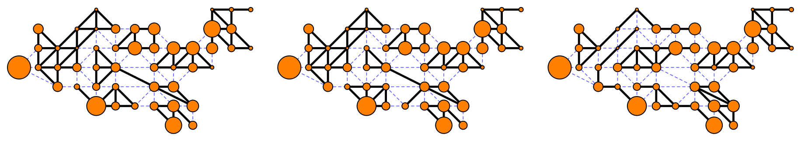

# TAOCP 7.2.2.1, Exercise 246: The Partitions Under the New Options

Written 24 November 2026, against the revised pages 115, 116 and 153 of
Volume 4B that Knuth put online in
[newpop48.tgz](https://cs.stanford.edu/~knuth/newpop48.tgz), with the options
file `contig48pop.dlx5` and the programs that came with them.

Shisheng Li found that the left-hand partition of 7.2.2.1–(116) was not
optimum. The pruning of exercise 242 had thrown away options that were needed,
because two of the options, the ones with New York, lie outside the range
[37 . . 39) million. Pages 115 and 116 have been redone. Knuth asked whether
the partitions printed in answer 246, which minimize exterior and interior
costs instead of squared populations, are still the best for the corrected
options.

## What I found

| Item | Finding |
| --- | --- |
| Answer 246, left, minimum exterior cost \$90 | **\$78** with the corrected options, by two partitions |
| Answer 246, left, minimum interior cost \$176 | **\$164**, by one partition |
| Answer 246, right, \$74 and \$230 | Unchanged; each attained by one partition, the one drawn |
| Exercise 246 as revised, "the 33,782 options … plus two options" | Should be **33,780**: page 116's 33,782 already includes the two |
| Page 116, "only 2.0 gigamems" | `DLX5` as posted needs 19.6 gigamems; a question, not a finding |
| Pages 115–116, the counts 1,926,811, 1,571,057, 355,754, 31,685 and 33,782 | Confirmed |
| Page 116, both optimum solutions unique, with the stated populations | Confirmed |

So the two left-hand pictures of answer 246 have to be redrawn; the two
right-hand ones stand.

The printed \$90 and \$176 are exactly the minima for the options that the old
pruning left: 31,685 connected sets plus the two New York options. A typical
casualty is `DE KY MD OH PA WV`, one of the clusters of the new optima. Removing
it cuts off New York, New England and New Jersey, 42.6 million people, and
that is not a sum of numbers in [37 . . 39) million; so the old test threw it
away, although the heavyweight New York option fills that component exactly.

## 1. The new optima

Minimum exterior cost, **\$78**, in two ways. The two partitions differ only in
where Mississippi and Oklahoma go:

| Cluster | Population | Cost |
| --- | ---: | ---: |
| CT ME MA NH NJ NY RI VT | 42,615,461 | \$3 |
| KS MO NE NC TN VA + OK (or + MS) | 38,303,028 (or 37,519,515) | \$23 |
| IL IN IA MI WI | 37,934,065 | \$10 |
| AL FL GA SC | 37,898,832 | \$5 |
| AR LA NM TX + MS (or + OK) | 37,622,837 (or 38,406,350) | \$9 |
| AZ CO ID MN MT ND NV OR SD UT WA WY | 37,353,369 | \$13 |
| CA | 37,252,895 | \$3 |
| DE KY MD OH PA WV | 37,103,693 | \$12 |

The next costs are \$80 (nine partitions) and \$82 (nine).

Minimum interior cost, **\$164**, in one way:

| Cluster | Population | Cost |
| --- | ---: | ---: |
| CT ME MA NH NJ NY RI VT | 42,615,461 | \$34 |
| GA NC SC TN VA | 38,197,094 | \$6 |
| CO IL IN IA KS MO NE | 38,060,371 | \$22 |
| AL AR FL LA MS OK | 37,753,906 | \$18 |
| AZ NM SD TX UT WY | 37,739,450 | \$20 |
| ID MI MN MT ND NV OR WA WI | 37,361,310 | \$52 |
| CA | 37,252,895 | \$0 |
| DE KY MD OH PA WV | 37,103,693 | \$12 |

The next costs are \$168 (four partitions), \$170 (ten) and \$172 (five).
Both optima use the heavyweight New York option, the one with New Jersey.

Drawn as the book draws them, the two partitions of exterior cost \$78 on the
left and middle, and the one of interior cost \$164 on the right:



With `contig48pop.dlx5` recosted in place, its order of options unchanged,
`DLX5` as posted finds the two optima in 33,770,420 + 4,168,652,101 mems and
34,785,498 + 7,012,557,682 mems. Counting only the mems of the search, as the
answer does for the right-hand problems (section 3), it would read "found in
4.2 G and 11 Mμ" for exterior costs and "7.0 G and 100 Mμ" for interior costs.

## 2. What the printed answer solved

The old pruning, which exempts nothing, leaves 31,685 of the 291,282
connected sets — the number page 116 gives for the options that have no
solution. With those and the two New York options, the minimum exterior
cost is \$90, attained by two partitions, and the minimum interior cost is
\$176, attained by one; the next costs are \$94 and \$180. The interior run
takes 1.69 gigamems, against "1700 Mμ" in the answer. The exterior run takes
1.22 gigamems against the printed 612 Mμ, and I can't account for that
difference.

The exterior picture of answer 246 is one of the two \$90 partitions, the one
with clusters `DE GA MD NC SC VA` and `AL FL LA MS TN`; the other has
`DE LA MD MS NC TN VA` and `AL FL GA SC` instead. The first printing's
statement of the exercise speaks of 34,111 options; I found no pruning that
gives that number, but 31,685 + 2 gives both printed costs.

## 3. The right-hand problems and page 116

The right-hand problems have no exceptional options, so the old pruning was
sound for them, and nothing changes. Of 1,587,884 connected sets in
[50.5 . . 51.5) million it leaves 36,190. The minimum exterior cost is \$74
and the minimum interior cost \$230, each attained by one partition, the one
that answer 246 draws; the next costs are \$78 and \$232 (two partitions).
`DLX5` takes 11.3 and 103.6 megamems, against the printed 11 and 100.

On page 116, `back-reachable-weighted-pruned-partly` reproduces
`contig48pop.dlx5` exactly: the same 33,780 options, to which the file adds
the two with New York. The minimum of the squared populations is attained
once, by a partition whose seven clusters without New York hold between
37,252,895 and 37,851,641 people. For the right-hand problem the minimum is
also attained once, with all six clusters between 50,655,442 and 51,140,193.

The running times are the one thing I could not match. `DLX5` as posted, with
its default parameters, takes 40,602,032 + 1,190,713,655 mems for the
right-hand problem, close to the printed 1.1 Gμ. For the left-hand problem it
takes 33,824,357 + 19,575,062,486 mems on `contig48pop.dlx5`, ten times the
printed "only 2.0 gigamems". Perhaps the 2.0 was meant to be 20, or it was
measured differently; I mention it only because the sentence is new.

## 4. How this was checked

Two routes that share nothing but the graph file `contiguous-usa-48.gb`.

**Knuth's own programs.** I merged the pruning of
`back-reachable-weighted-pruned-partly.ch` with the cost computation of
`back-reachable-weighted-pruned-extcosts.ch` and `…-intcosts.ch`, giving
[back-reachable-weighted-pruned-partly-extcosts.ch](back-reachable-weighted-pruned-partly-extcosts.ch)
and
[back-reachable-weighted-pruned-partly-intcosts.ch](back-reachable-weighted-pruned-partly-intcosts.ch).
Each, run with `37000000 39000000 contiguous-usa-48.gb NY`, writes the same
33,780 options as `contig48pop.dlx5`, in the same order, with the other cost.
The two New York options cost \$2 and \$3 (exterior) and \$22 and \$34
(interior). Then `dlx5.w` as posted, with `k20` to see the ties.

**A program of my own,** [verify/verify.gw](verify/verify.gw)
([PDF](verify/verify.pdf)). It restores the graph with a Go port of the
GraphBase, enumerates the connected sets by a different method (growing each
set from its least vertex, with an exclusion set instead of Knuth's
lexicographically smallest proofs), applies the test of exercise 242 with and
without the New York exemption, computes both costs, and finds the 20 cheapest
partitions with the branch-and-bound solver of this repository. It also checks
that every partition the solver returns really is a partition into options.

The two option lists, with their costs, agree line for line for every problem
here, and so do the twenty cheapest costs. What that protects: the
enumeration, the pruning, the costs and the search were each done twice by
code written independently. One thing it does not protect is the pruning
*argument* itself, since both routes apply the same test. So the program was
also run with `-prune=false`, which hands every connected set in range to the
solver — 291,282 + 2 options on the left and 1,587,884 on the right — and it
gives the same minima, the same partitions and the same twenty cheapest costs.
(Without pruning, the two problems "of 2018" become the corrected ones, so
that run says nothing new about them.)

The check that the solver returns real partitions was not idle. Its first run
caught this repository's solver reporting covers that left a state out, such
as one of interior cost \$162 that never covered Montana: a forced move left
over from a branch abandoned on cost made a later node branch on the wrong
item. That is fixed in [ssxcc.gw](../../ssxcc.gw), and every number above
comes from the fixed solver.

## 5. Reproducing

```sh
cd verify
gtangle verify.gw
go run . -mp partitions.mp          # pruned, as in exercise 242: about 20 s
go run . -prune=false               # every connected set in range
```

and, with the Stanford GraphBase and Knuth's files from the tarball,

```sh
ctangle back-reachable-weighted.w back-reachable-weighted-pruned-partly-extcosts.ch
cc -o brw-ext back-reachable-weighted.c -lgb
./brw-ext 37000000 39000000 contiguous-usa-48.gb NY > ext.dlx5
# append the two New York options, with costs 2 and 3
dlx5 k20 < ext.dlx5
```
